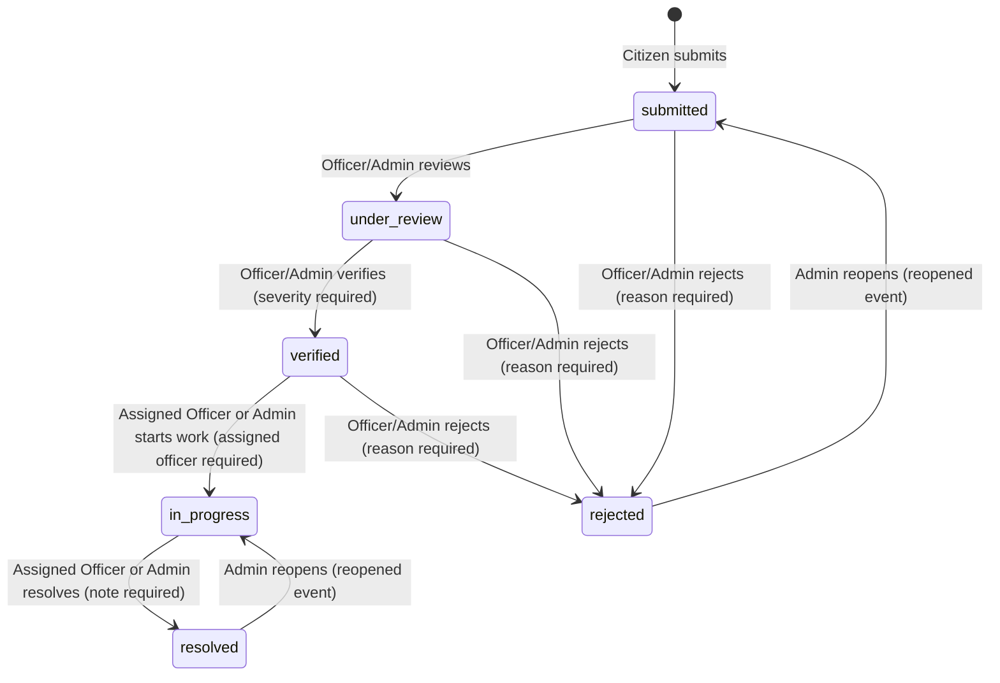
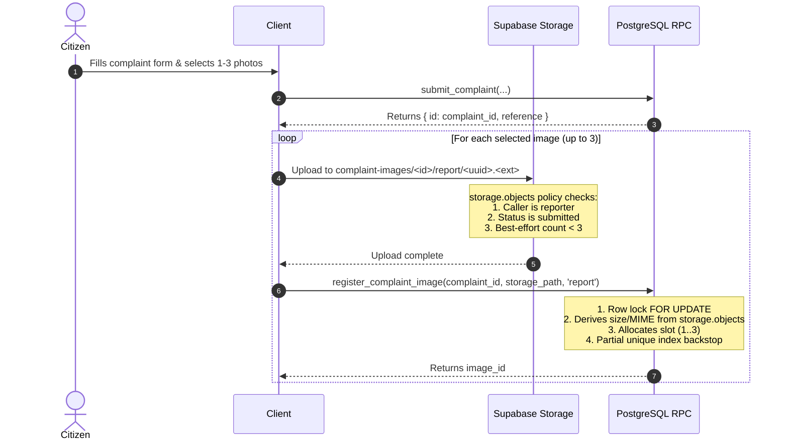

# RoadFix Backend Architecture & Database Specification (Phase 2A)

This document provides the complete technical specification for the RoadFix civic-tech pothole reporting database foundation (initial city: Agra, Uttar Pradesh, India).

---

## 1. Architecture Overview

RoadFix uses a **hardened, database-centric security model** built on PostgreSQL and Supabase. Rather than relying on middleware or client-side checks, all core business rules, rate limiting, role authorizations, and data validation are enforced directly inside PostgreSQL through:

1. **Strict Row Level Security (RLS)**: Enforces visibility at the row level for all queries.
2. **Column-Level Privilege Revocation**: Sensitive foreign keys (`reporter_id`, `uploaded_by`) are withheld from API roles (`authenticated`, `anon`).
3. **Dedicated Private Schema**: Authorization helper functions reside in a non-exposed `private` schema with `SECURITY DEFINER` semantics and empty `search_path`.
4. **Transaction-Safe RPCs**: All mutations occur via dedicated `SECURITY DEFINER` stored procedures executing row locking (`FOR UPDATE`) and advisory transaction locks.
5. **Immutable Audit Trails**: Status changes and administrative actions are logged to append-only tables guarded by PostgreSQL triggers.

---

## 2. Role Matrix

RoadFix implements three mutually exclusive application roles defined in `public.app_role`:

| Role          | Description                                 | Submission Rights                  | View Scope                                                                                                     | Transition Rights                                                 |
| :------------ | :------------------------------------------ | :--------------------------------- | :------------------------------------------------------------------------------------------------------------- | :---------------------------------------------------------------- |
| **`citizen`** | Standard registered resident                | Can submit complaints (max 10/day) | Own submitted complaints only                                                                                  | None (read-only tracking)                                         |
| **`officer`** | Municipal road maintenance personnel        | None (cannot submit complaints)    | Complaints in `submitted`, `under_review`, `verified` across Agra, OR complaints specifically assigned to them | Allowed transitions within their assignment                       |
| **`admin`**   | System administrator / Municipal supervisor | None                               | All complaints, all roles, full audit log                                                                      | All status transitions, reassignment, reopenings, role management |
| **`anon`**    | Unauthenticated public visitor              | None                               | Single complaint status via `track_complaint(reference)`                                                       | None                                                              |

---

## 3. Complaint Status Transition Matrix

Complaints move through 6 distinct statuses: `submitted`, `under_review`, `verified`, `in_progress`, `resolved`, `rejected`. Assignment to an officer is stored in `assigned_officer_id` and is **not** a status.



### Complete Transition Rules:

1. `submitted` -> `under_review`: Officer or Admin.
2. `under_review` -> `verified`: Officer or Admin. Severity (`low`, `medium`, `high`) is **mandatory**.
3. `submitted` | `under_review` | `verified` -> `rejected`: Officer or Admin. Rejection note is **mandatory** and stored in `rejection_reason` (citizen-visible).
4. `verified` -> `in_progress`: Assigned Officer or Admin. `assigned_officer_id` must be set; if caller is an officer, they must match `assigned_officer_id`.
5. `in_progress` -> `resolved`: Assigned Officer or Admin. Resolution note is **mandatory** and stored in `resolution_note`; sets `resolved_at = now()`.
6. `rejected` -> `submitted`: **Admin only**. Note is mandatory; records `event_type = 'reopened'`; clears `rejection_reason`.
7. `resolved` -> `in_progress`: **Admin only**. Note is mandatory; `assigned_officer_id` must be set; records `event_type = 'reopened'`; clears `resolution_note` and `resolved_at`.

Citizens can never transition status under any circumstances.

---

## 4. Database Schema and Application Tables

All RoadFix tables reside in the `public` schema.

### `public.profiles`

- `id` (uuid, PK, references `auth.users(id)` on delete cascade)
- `display_name` (text, nullable, check length between 1 and 80)
- `created_at` (timestamptz, not null, default `now()`)
- `updated_at` (timestamptz, not null, default `now()`)

### `public.user_roles`

- `user_id` (uuid, PK, references `auth.users(id)` on delete cascade)
- `role` (public.app_role, not null, default `'citizen'`)
- `granted_by` (uuid, references `auth.users(id)` on delete set null)
- `granted_at` (timestamptz, not null, default `now()`)

### `public.complaints`

- `id` (uuid, PK, default `gen_random_uuid()`)
- `reference` (text, unique, not null, format `^RF-[A-Z]{2,3}-[0123456789ABCDEFGHJKMNPQRSTVWXYZ]{8}$`)
- `reporter_id` (uuid, nullable, references `auth.users(id)` on delete set null)
- `description` (text, not null, check length between 10 and 1000)
- `latitude` (double precision, not null, check between -90.0 and 90.0)
- `longitude` (double precision, not null, check between -180.0 and 180.0)
- `location_description` (text, nullable, check length <= 150)
- `city_code` (text, not null, default `'AG'`)
- `city_name` (text, not null, default `'Agra'`)
- `status` (public.complaint_status, not null, default `'submitted'`)
- `status_updated_at` (timestamptz, not null, default `now()`)
- `severity` (public.severity_level, nullable)
- `assigned_officer_id` (uuid, nullable, references `auth.users(id)` on delete set null)
- `assigned_at` (timestamptz, nullable)
- `rejection_reason` (text, nullable)
- `resolution_note` (text, nullable)
- `resolved_at` (timestamptz, nullable)
- `created_at` (timestamptz, not null, default `now()`)
- `updated_at` (timestamptz, not null, default `now()`)

### `public.complaint_images`

- `id` (uuid, PK, default `gen_random_uuid()`)
- `complaint_id` (uuid, not null, references `public.complaints(id)` on delete restrict)
- `uploaded_by` (uuid, nullable, references `auth.users(id)` on delete set null)
- `kind` (public.image_kind, not null: `'report'` or `'repair_evidence'`)
- `slot` (smallint, nullable: 1..3 for report, null for repair_evidence)
- `storage_path` (text, unique, not null, regex checked)
- `content_type` (text, not null, check in `'image/jpeg'`, `'image/png'`, `'image/webp'`)
- `size_bytes` (bigint, not null, check between 1 and 5242880 [5MB])
- `created_at` (timestamptz, not null, default `now()`)
- **Engine-Level Hard Cap**: Unique partial index on `(complaint_id, slot) WHERE kind = 'report'`.

### `public.complaint_status_history`

- `id` (bigint, identity PK)
- `complaint_id` (uuid, not null, references `public.complaints(id)` on delete restrict)
- `event_type` (public.history_event, not null: `'created'`, `'status_change'`, `'assignment'`, `'reopened'`)
- `from_status` (public.complaint_status, nullable)
- `to_status` (public.complaint_status, nullable)
- `assignee_id` (uuid, nullable, references `auth.users(id)` on delete set null)
- `actor_id` (uuid, nullable, references `auth.users(id)` on delete set null)
- `actor_role` (public.app_role, not null)
- `note` (text, nullable, internal staff note)
- `created_at` (timestamptz, not null, default `now()`)

### `public.admin_audit_log`

- `id` (bigint, identity PK)
- `admin_id` (uuid, nullable, references `auth.users(id)` on delete set null)
- `action` (text, not null)
- `target_complaint_id` (uuid, nullable)
- `target_user_id` (uuid, nullable)
- `details` (jsonb, default `'{}'::jsonb`)
- `created_at` (timestamptz, not null, default `now()`)

---

## 5. Column-Level Privilege Architecture

> [!IMPORTANT]
> PostgREST and the Supabase Client enforce column-level privileges at SQL evaluation time.
>
> - Direct queries executing `supabase.from('complaints').select('*')` will **FAIL** with PostgreSQL error `42501 (permission denied for column reporter_id)`.
> - Direct queries executing `supabase.from('complaint_images').select('*')` will **FAIL** with PostgreSQL error `42501 (permission denied for column uploaded_by)`.
>
> Frontend and API clients **MUST explicitly name allowed columns**:
>
> ```typescript
> const { data, error } = await supabase
>   .from("complaints")
>   .select(
>     "id, reference, description, latitude, longitude, location_description, status, severity, created_at"
>   );
> ```

---

## 6. Stored Procedures (RPCs)

All mutations occur through `SECURITY DEFINER` functions with `search_path = ''`:

### 1. `public.submit_complaint(p_description text, p_latitude double precision, p_longitude double precision, p_location_description text default null)`

- **Callable by**: `authenticated` (must hold `'citizen'` role).
- **Rate limit**: Advisory transaction lock + count check (max 10 complaints in past 24 hours per user).
- **Validation**: Enforces valid coordinate ranges (-90 to 90 for latitude, -180 to 180 for longitude), description 10-1000 characters, location description <= 150 characters with PII rejection (no `@`, no 7+ digit runs).
- **Collision Retry**: Implements bounded retry (up to 5 attempts) on reference collision during complaint insertion.
- **Output**: Returns `(id uuid, reference text)`.

### 2. `public.register_complaint_image(p_complaint_id uuid, p_storage_path text, p_kind public.image_kind)`

- **Callable by**: `authenticated`.
- **Concurrency**: Acquires `SELECT ... FOR UPDATE` lock on complaint row.
- **Verification**: Verifies storage object exists in bucket `complaint-images`, `owner_id` matches caller (using NULL-safe comparison `IS DISTINCT FROM`; NULL ownership is strictly rejected), derives MIME and size from storage metadata (never trusts client input).
- **Report image**: Status must be `submitted`, caller must be reporter, allocates lowest available slot (1..3).
- **Repair evidence**: Status must be `in_progress`, caller must be assigned officer or admin, slot is NULL.
- **Output**: Returns image UUID.

### 3. `public.transition_complaint_status(p_complaint_id uuid, p_to_status public.complaint_status, p_note text default null, p_severity public.severity_level default null)`

- **Callable by**: `authenticated` (`officer` or `admin`).
- **Concurrency**: Acquires `SELECT ... FOR UPDATE` lock on complaint row.
- **Rules**: Enforces exact state transition matrix and writes immutable history record in the same transaction.

### 4. `public.assign_complaint(p_complaint_id uuid, p_officer_id uuid)`

- **Callable by**: `authenticated` (`admin` only).
- **Concurrency**: Row lock `FOR UPDATE`.
- **Rules**: Target must hold role `'officer'`, complaint status must be `'verified'` or `'in_progress'`. Sets `assigned_officer_id` and records history event `'assignment'`.

### 5. `public.admin_set_role(p_user_id uuid, p_role public.app_role)`

- **Callable by**: `authenticated` (`admin` only).
- **Safety**: Advisory transaction lock `admin_role_change`. Prevents demoting the last remaining administrator. Logs to `admin_audit_log`.

### 6. `public.admin_get_reporter(p_complaint_id uuid)`

- **Callable by**: `authenticated` (`admin` only).
- **Output**: Returns `(reporter_id uuid, display_name text)` (no email).
- **Audit**: Writes audit log record on every invocation.

### 7. `public.track_complaint(p_reference text)`

- **Callable by**: `anon` and `authenticated`.
- **Properties**: `STABLE`.
- **Output**: Returns public fields only: `(reference, status, submitted_at, status_updated_at, location_description)`.
- **Safety**: Normalizes input (trim, uppercase). Returns empty result (0 rows) for unknown or malformed references without leaking errors.

---

## 7. Storage Layout and Image Flow

Bucket: `complaint-images` (private, 5 MB limit, JPEG/PNG/WebP only).

### File Path Hierarchy:

- Report images: `<complaint_id>/report/<image_id>.<ext>`
- Repair evidence: `<complaint_id>/evidence/<image_id>.<ext>`

### Citizen Upload Lifecycle:



---

## 8. Concurrency Design

1. **Complaint Image Limit (Race Proof)**:
   - Storage upload policy performs a **best-effort check** (`count < 3`).
   - The **authoritative limit** is enforced in `register_complaint_image` via a row lock `SELECT ... FOR UPDATE` on the complaint, followed by assignment to the lowest free slot in `1..3`.
   - The PostgreSQL engine enforces the **hard backstop** with a partial unique index:
     ```sql
     create unique index complaint_images_report_slot_uidx on public.complaint_images (complaint_id, slot) where kind = 'report';
     ```
   - Any concurrent attempt to register a 4th image is guaranteed to fail with a clean error.
2. **Orphaned Storage Objects**:
   - If a client uploads a file to storage but fails before calling `register_complaint_image`, the storage object is an **orphan**.
   - Because all client queries join on `public.complaint_images`, unregistered orphans are never displayed, counted, or visible to users. A background cleanup job can sweep unregistered objects older than 24 hours.
3. **Daily Submission Rate Limiting**:
   - Guarded by PostgreSQL transaction-level advisory locks:
     ```sql
     perform pg_advisory_xact_lock(hashtext('complaint_submission_' || auth.uid()::text));
     ```
   - Serializes concurrent submissions for the same user account without locking other users.
4. **Last-Admin Demotion**:
   - Guarded by transaction advisory lock `hashtext('admin_role_change')`.
   - Concurrent demotions cannot race past the minimum admin count check.

---

## 9. Supabase-Managed Objects Policy

To avoid breaking Supabase platform services, GoTrue auth, or storage infrastructure:

- **Untouched**: `auth.users`, `storage.objects`, and `storage.buckets` **DO NOT** have blanket `REVOKE` or `ALTER TABLE ... DISABLE RLS` statements applied.
- **Specific Attachments Only**:
  - `auth.users`: Single `AFTER INSERT` trigger `on_auth_user_created` firing `public.handle_new_user()`.
  - `storage.buckets`: Insertion/verification for `complaint-images` bucket (fails safely if existing configuration is incompatible).
  - `storage.objects`: Exactly three named policies prefixed with `roadfix_`:
    - `roadfix_complaint_images_insert_report`
    - `roadfix_complaint_images_insert_evidence`
    - `roadfix_complaint_images_select`

---

## 10. Manual Steps for the Project Owner

### 1. Applying Migrations to a Supabase Dev Project

When ready to connect a real development Supabase project:

1. Open the Supabase Project Dashboard -> **SQL Editor**.
2. Run the 8 migration files in sequence:
   - `supabase/migrations/20261108100001_create_enums_and_tables.sql`
   - `supabase/migrations/20261108100002_create_indexes.sql`
   - `supabase/migrations/20261108100003_create_private_schema_and_helpers.sql`
   - `supabase/migrations/20261108100004_create_signup_trigger.sql`
   - `supabase/migrations/20261108100005_create_rls_and_privileges.sql`
   - `supabase/migrations/20261108100006_create_rpcs.sql`
   - `supabase/migrations/20261108100007_create_immutability_and_updated_at_triggers.sql`
   - `supabase/migrations/20261108100008_create_storage_bucket_and_policies.sql`

### 2. Creating the First Administrator

Because there is no public admin registration route, the first administrator must be designated manually via the SQL Editor:

```sql
-- Replace with the exact registered email of the project administrator
do $$
declare
  v_user_id uuid;
begin
  select id into v_user_id
  from auth.users
  where email = 'admin@roadfix-agra.in'; -- <--- REPLACE WITH YOUR REAL EMAIL

  if v_user_id is null then
    raise exception 'User not found. Register the user in Auth first.';
  end if;

  update public.user_roles
  set
    role = 'admin'::public.app_role,
    granted_at = now()
  where user_id = v_user_id;

  insert into public.admin_audit_log (admin_id, action, target_user_id, details, created_at)
  values (v_user_id, 'bootstrap_first_admin', v_user_id, '{"source": "initial_bootstrap"}'::jsonb, now());
end;
$$;
```

### 3. Post-Migration Verification Checklist

1. Register a new test user in the Supabase Auth dashboard.
2. Confirm that a corresponding row in `public.profiles` was automatically created.
3. Confirm that a corresponding row in `public.user_roles` with `role = 'citizen'` was automatically created.
4. Attempt `SELECT * FROM complaints;` using an authenticated client and verify that PostgreSQL returns `42501 (permission denied for column reporter_id)`.

---

## 11. Manual Two-Session Concurrency Test Procedure

To verify race-condition resistance on a disposable PostgreSQL development database:

### Test A: Slot Conflict on 3rd Image Slot

1. In Session 1, begin a transaction and lock the complaint:
   ```sql
   -- Session 1:
   BEGIN;
   SELECT * FROM complaints WHERE id = '<test-uuid>' FOR UPDATE;
   -- Do not commit yet.
   ```
2. In Session 2, attempt to register image into the last remaining slot:
   ```sql
   -- Session 2:
   SELECT register_complaint_image('<test-uuid>', '<test-uuid>/report/<img2>.jpg', 'report');
   -- Notice Session 2 blocks waiting for the row lock.
   ```
3. In Session 1, register an image and commit:
   ```sql
   -- Session 1:
   SELECT register_complaint_image('<test-uuid>', '<test-uuid>/report/<img1>.jpg', 'report');
   COMMIT;
   ```
4. Session 2 unblocks immediately, detects that slot 3 is already taken, and raises `Image limit reached (maximum 3 report images allowed)`.

### Test B: Rate Limiting Concurrency

1. In Session 1 and Session 2, run `submit_complaint` simultaneously at the 10th complaint boundary:
2. The transaction advisory lock ensures one transaction evaluates `count = 9` and succeeds, while the serialized concurrent transaction evaluates `count = 10` and raises `Daily submission limit reached`.

---

## 12. Known Limitations & Future Work

1. **Public Tracking Rate Limiting**: `track_complaint` is open to anonymous visitors. In Phase 2A, DDoS protection relies on edge CDN / API gateway rate limiting. Application-layer IP rate limiting will be evaluated in Phase 2B.
2. **Location PII Filtering**: The check on `location_description` uses heuristic pattern matching (`@` and 7+ digit runs). It is a best-effort defense and not a full PII scrubber.
3. **Assigned Officer UUID**: When a complaint enters `in_progress`, the reporter can view `assigned_officer_id` (a UUID). Officer names and contact details remain protected in staff tables.
4. **Storage Orphan Cleanup**: Unregistered images remain in storage until cleaned up by an automated lifecycle rule or scheduled edge function.
